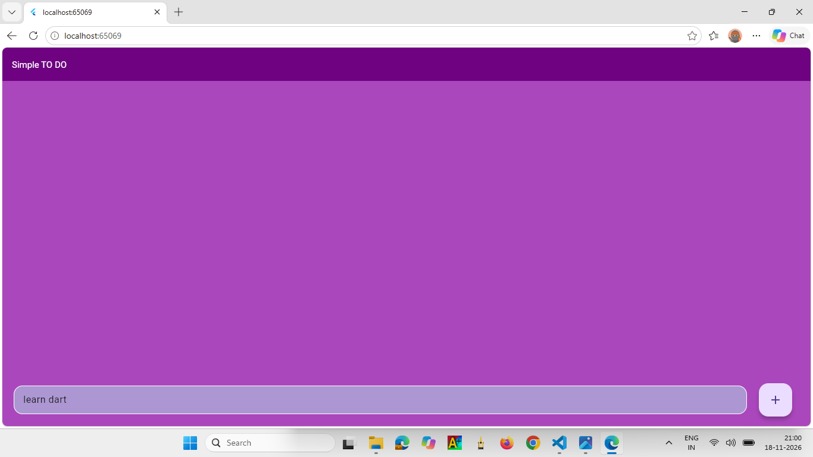

# Flutter To-Do App

A simple To-Do List application built using Flutter and Hive.

## Features
- Add tasks
- Mark tasks as completed
- Delete tasks
- Edit tasks
- Store data locally using Hive

## Technologies Used
- Flutter
- Dart
- Hive

## App Screenshots

### Home Screen

### Add Task

### Delete and Edit

### Edit Task

### After Editing

### Completed Task

=======
# flutter-todo-app
A Flutter To-Do List application with Hive local storage, adding task ,edit existing tasks, task completion, and a clean, responsive user interface
